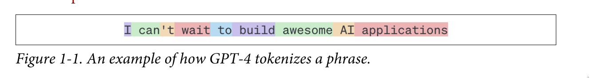
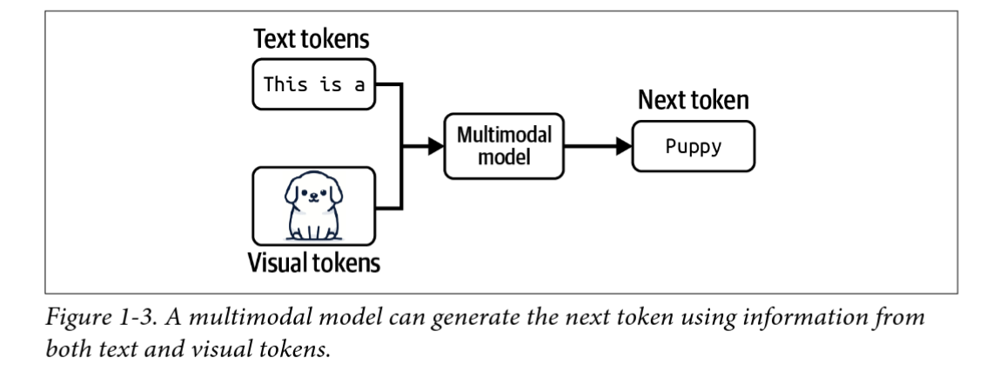

### AI Engineering   
Building applications on top of machine learning (ML) models isn’t new.     
Long before LLMs became prominent, AI was already powering many applications,    
including product recommendations, fraud detection, and churn prediction.    

`Foundation models` emerged from `large language models`, which, in turn, originated as just `language models`.    

#### Language Model (LM)   
**Token prediction**: LM computes the likelihood of a word in a given context.   
Prediction and Entropy of English.    

While language models have been around for a while,    
they’ve only been able to grow to the scale they are today with `self-supervision`.    

A language model `encodes statistical information` about one or more languages(e.g. English, German, Dutch, ...).    
The basic unit of a language model is `token`:    
A token can be a character, a word, or a part of a word (like -tion), depending on the model.    

The process of breaking the original text into tokens is called `tokenization`.    
for example for the GPT-4 model:    
$$
\text{words} \times \frac{4}{3} = \text{tokens}
$$

> [!WARNING]
> For non-English languages, a single Unicode character can sometimes be represented as multiple tokens.

The set of all tokens a model can work with is the model’s `vocabulary`.

There are two main types of language models:
- masked language models
  - is trained to **predict missing tokens** anywhere in a
    sequence, using the context from both before and after the missing tokens.
  - commonly used for non-generative
    tasks such as debugging.
- autoregressive language models
  - is trained to predict the next token in a
    sequence, using only the preceding tokens.
  - can continually generate one
    token after another

The outputs of autoregressive language models are **open-ended**. A language model can use its fixed,    
finite vocabulary to construct infinite possible outputs. A model that can generate    
open-ended outputs is called `generative`, hence the term generative AI.    

Language modeling is just one of many **ML algorithms**. There are also models for    
object detection, topic modeling, recommender systems, weather forecasting, stock    
price prediction, etc.   

language models can be trained using `self-supervision`, while many other models require `supervision`.    
**Supervision**: Supervision refers to the process of training ML    
algorithms using `labeled data`, which can be expensive and slow to obtain.    
**Labeling**: label examples to show the behaviors you want the model to learn.    
for example: this Image is labeled as *Balloon*, and this Image is labeled as *Car*    

**self-supervision**: instead of requiring explicit labels, the model can infer labels from the input data.    
> Self-supervised learning means that language models can learn from text sequences   
> without requiring any labeling. Because text sequences are everywhere—in books,   
> blog posts, articles, and Reddit comments—it’s possible to construct a massive   
> amount of training data, allowing language models to scale up to become LLMs.   

A model’s size is typically measured by its number of `parameters`. A parameter is a variable    
within an ML model that is updated through the training process.    
In general though this is not always true, the more parameters a model has, the greater its    
capacity to learn desired behaviors.

> As of the writing of this book, a model with 100 billion parameters is considered large.    
> Perhaps one day, this size will be considered small.

You can train a large model on a small dataset too, but it’d be a waste of compute.    
You could have achieved similar or better results on this dataset with smaller models.    

### Foundation Model
While language models are capable of incredible tasks, they are limited to text.
`data modalities` include: Text, 3D Assets, Audio, Image, ...
A model that can work with more than one data modality is also called a multimodal model.    

Just like language models, multimodal models need data to scale up.    
**Self-supervision works for multimodal models too**   

> This book[AI Engineering] uses the term foundation models to refer 
> to both large language models and large multimodal models.   

### Resources
- [AI Engineering book](https://www.amazon.com/dp/1098166302)